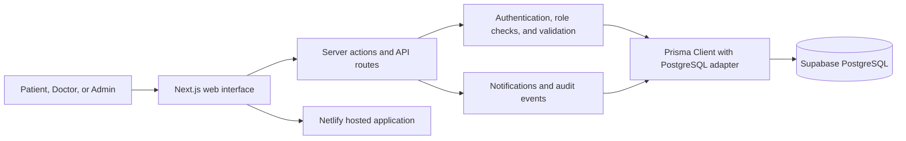

# HealSync: Hospital Appointment Management System

## Mini Project Report

| Field | Details |
| --- | --- |
| Project title | HealSync — Hospital Appointment Management System |
| Project category | Full-stack web application |
| Prepared by | `[Student name]` |
| Roll number | `[Roll number]` |
| Department / class | `[Department and class]` |
| Institution | `[College name]` |
| Project guide | `[Guide name]` |
| Academic year | `[Academic year]` |

> Replace the bracketed fields with your details before submitting or presenting this report.

## Abstract

HealSync is a web-based appointment management system that connects patients, doctors, and hospital administrators. Patients can browse departments and approved doctors, review availability, and request appointments. Doctors can manage their profiles and schedules, respond to appointment requests, and record consultation information. Administrators can manage departments, review doctor approval status, oversee users and appointments, and inspect audit records.

The application uses Next.js and TypeScript for its web interface and server-side logic, Prisma for database access, and PostgreSQL for persistent data storage. It includes role-based access controls, server-side input validation, appointment conflict checks, notifications, and audit logging. The project is intended as an academic prototype and demonstration; it is not a certified clinical record system.

## 1. Introduction

Hospitals and clinics coordinate appointments among patients, doctors, and administrative staff. When this work is handled through calls, paper records, or disconnected tools, it can be difficult to see a doctor's availability, track a request, or keep appointment information organized.

HealSync provides a shared application for these workflows. Each user is given a role and sees the features relevant to that role. Appointment information is stored in a relational database, while server-side rules check schedules and booking conflicts.

## 2. Problem Statement

Patients need a clear way to find suitable doctors and request available appointment times. Doctors need a manageable queue of appointment requests and a way to maintain their schedules. Administrators need tools to organize departments and oversee the system. A manual or fragmented workflow makes these tasks harder to coordinate and increases the risk of duplicate or invalid bookings.

## 3. Aim and Objectives

### Aim

To build a role-based web application for organizing doctor discovery, appointment requests, and basic hospital administration.

### Objectives

- Provide separate patient, doctor, and administrator experiences.
- Allow patients to search approved doctors and browse hospital departments.
- Generate appointment slots from a doctor's weekly schedule.
- Check doctor availability, leave dates, and conflicting bookings before saving a request.
- Let doctors accept, reject, cancel, or complete appointments.
- Store consultation notes and notify relevant users about appointment events.
- Give administrators tools for department management, doctor approval, user oversight, and audit review.
- Apply server-side validation and role checks to important operations.

## 4. Project Scope

### Included

- Patient and doctor account registration and login.
- Administrator, doctor, and patient roles.
- Doctor profiles, departments, weekly availability, and leave dates.
- Appointment request and status workflows.
- Patient and doctor appointment dashboards and history.
- Consultation records, notifications, and audit events.
- PostgreSQL storage accessed through Prisma.
- Local development and deployment configuration for Netlify with a hosted PostgreSQL database.

### Outside the current scope

- Electronic prescriptions sent to pharmacies.
- Online payments, insurance claims, or billing integrations.
- Video consultations or real-time chat.
- Automated email or SMS delivery.
- A complete, audited password recovery workflow. The current recovery pages are placeholders.
- Compliance certification or production approval for storing real medical records.

## 5. Users and Main Modules

| User role | Main capabilities |
| --- | --- |
| Patient | Register and sign in, manage a patient profile, browse departments and doctors, request appointments, review appointment history and consultation details, and view notifications. |
| Doctor | Manage professional profile, set weekly availability and leave dates, review appointment requests, accept or reject requests, cancel or complete appointments, and record consultation details. |
| Administrator | View dashboards, manage departments and users, approve or disable doctors, oversee appointments and notifications, and review audit logs. |

### Main application modules

1. **Authentication and authorization** — account registration, login, logout, sessions, and role checks.
2. **Doctor directory** — department browsing, doctor search, profile details, and public availability information.
3. **Scheduling** — weekly hours, appointment slot generation, leave handling, and conflict prevention.
4. **Appointment management** — request creation and doctor/patient/admin status workflows.
5. **Consultation records** — symptoms, diagnosis, notes, prescriptions, follow-up date, and instructions.
6. **Notifications and auditing** — event notifications and administrative activity records.
7. **Administration** — departments, users, doctors, appointments, settings, dashboards, and audit history.

## 6. Technology Stack

| Technology | Use in the project |
| --- | --- |
| Next.js App Router | Web pages, server components, server actions, API route handlers, and server rendering. |
| React | Reusable interactive user interface components. |
| TypeScript | Type checking for application code and data structures. |
| Tailwind CSS | Page layout and visual styling. |
| Prisma ORM | Relational data modeling, generated client, and database queries/migrations. |
| PostgreSQL | Persistent relational database; the project is configured to use Supabase PostgreSQL. |
| `@prisma/adapter-pg` and `pg` | PostgreSQL driver adapter for Prisma. |
| Zod | Validation of form and request data on the server. |
| bcryptjs | Password hashing and password verification. |
| date-fns | Date and time calculations for schedule generation. |
| Lucide React | Interface icons. |
| Recharts | Dashboard charts and data visualization. |
| Vitest | Unit tests for selected business rules and validation. |
| Netlify | Hosting and deployment from the Git repository. |

## 7. System Architecture



Most database operations run on the server. Server components load role-specific data; server actions handle form submissions; API route handlers expose selected application operations. Prisma maps application models to PostgreSQL tables.

## 8. Database Design

The database uses relational models and foreign-key relationships. Primary identifiers are generated by Prisma. Enumerated fields constrain roles, account status, doctor approval state, appointment status, and notification type.

| Model | Purpose and key relationships |
| --- | --- |
| `User` | Shared identity, unique email, password hash, role, status, and timestamps. Has an optional one-to-one patient or doctor record. |
| `Session` | Stores the user session identifier and expiry time. Sessions are linked to users and removed when the user is deleted. |
| `Patient` | Patient-specific profile fields and relationships to appointments and consultations. |
| `Doctor` | Professional profile, department, languages, approval state, availability, leave, appointments, and consultations. |
| `Department` | Department name, description, active state, and relationships to doctors and appointments. |
| `Availability` | One weekly schedule rule per doctor and day, including start/end time and slot duration. |
| `DoctorLeave` | Doctor leave date and optional reason. A doctor cannot have duplicate leave records for the same date. |
| `Appointment` | Patient, doctor, department, date, time, reason, status, conflict keys, and cancellation/rejection details. |
| `Consultation` | Consultation details linked to an appointment, doctor, and patient. One consultation can be associated with an appointment. |
| `Notification` | User-specific messages with category, read state, and creation time. |
| `AuditLog` | Records administrative or workflow actions, entity references, optional metadata, and timestamp. |

### Relationship overview

- A `User` can have one `Patient` profile or one `Doctor` profile.
- A `Department` can contain multiple doctors and appointments.
- A `Doctor` can have several availability rules, leave dates, appointments, and consultations.
- A `Patient` can have multiple appointments and consultations.
- An appointment belongs to one patient, one doctor, and one department; it can have one consultation.
- A user can have multiple sessions and notifications.

## 9. Appointment Workflow and Business Rules

### Appointment lifecycle

```text
REQUESTED ──> ACCEPTED ──> COMPLETED
     │             │
     ├──> REJECTED └──> CANCELLED
     └──> CANCELLED
```

Completed, rejected, and cancelled appointments are terminal in the current workflow. Patients, assigned doctors, and administrators have different permissions for appointment actions.

### Booking checks

When a patient requests an appointment, the server checks that:

1. The requested date is not in the past.
2. The patient has a patient profile.
3. The doctor exists, is active, and has been approved.
4. The selected department matches the doctor's department and is active.
5. The doctor is not on leave for that date.
6. The selected time falls within the doctor's active weekly schedule and aligns with its slot duration.
7. The doctor and patient do not already have a conflicting booking for that slot.

The booking is created in a database transaction. Unique conflict keys provide a database-level safeguard against duplicate doctor and patient slots. Related notifications and audit records are written as part of the workflow.

## 10. Security and Data Handling

- Passwords are hashed with bcryptjs before storage; plaintext passwords are not stored.
- Session tokens are signed with HMAC-SHA256 and placed in HTTP-only cookies.
- Session cookies use `SameSite=Lax`, a root path, an expiry, and the `Secure` flag in production.
- Sessions expire after seven days and are checked against the database.
- Server-side role checks protect pages and mutations.
- Zod schemas validate user-provided form data before important database writes.
- Database credentials and `AUTH_SECRET` belong in environment variables and must not be committed or included in project reports.

This is an academic prototype. Before storing real patient information, it needs a formal security and privacy review, a production password reset flow, rate limiting, operational monitoring, backups, retention policies, and compliance review for the applicable jurisdiction.

## 11. Installation and Running Locally

### Prerequisites

- Node.js and npm.
- A PostgreSQL database. The current project setup uses Supabase PostgreSQL.
- Git, if cloning the project repository.

### Setup

1. Install project dependencies:

   ```bash
   npm install
   ```

2. Create a local `.env` file with valid database URLs and a strong random session secret. Use the values from Supabase's **Connect** screen. The transaction pooler URL is used at runtime; the session pooler URL is used for migrations.

   ```env
   DATABASE_URL="<Supabase transaction-pooler PostgreSQL URL>"
   DIRECT_URL="<Supabase session-pooler PostgreSQL URL>"
   AUTH_SECRET="<long random secret>"
   ```

   URL-encode reserved characters in database passwords. Do not share or commit `.env`.

3. Apply migrations and load development sample data:

   ```bash
   npm run db:setup
   ```

4. Start the development server:

   ```bash
   npm run dev
   ```

5. Open `http://localhost:3000` in a browser.

### Sample development accounts

The seed script creates these demo accounts. They all use the same sample password shown below. Do not use these accounts or password in a production deployment.

| Role | Email |
| --- | --- |
| Administrator | `admin@healsync.local` |
| Doctor | `doctor1@healsync.local` |
| Patient | `patient1@healsync.local` |

**Sample password:** `Password@123`

## 12. Deployment

The repository can be connected to Netlify for Git-based deployment. The production environment must have valid `DATABASE_URL`, `DIRECT_URL`, and `AUTH_SECRET` values configured in Netlify's environment variable settings. A local SQLite file is not used for this deployment; Netlify functions need a hosted database for durable shared data.

The build command is `npm run build`. Database migrations should be applied to the hosted database as part of the deployment/setup process, and the database must contain the expected schema before users access the application. Never place credentials in source code, screenshots, reports, or Git commits.

## 13. Testing and Verification

The repository includes focused Vitest tests for:

- Registration and login input validation.
- Appointment time-slot generation and schedule boundary checks.
- Appointment status transitions and cancellation rules.
- Deterministic booking conflict keys.
- Role-based patient record access rules.

Useful project commands:

```bash
npm run typecheck
npm run lint
npm test
npm run build
```

## 14. Limitations and Future Enhancements

### Current limitations

- Password recovery actions are placeholders and do not send or verify reset tokens.
- Notifications are stored in the database, but there is no email or SMS delivery integration.
- There is no payment, billing, insurance, or telemedicine integration.
- The project has not undergone healthcare compliance certification or an independent penetration test.
- Sample accounts and seed data are intended only for development and demonstrations.

### Possible future work

- Add a secure, token-based password reset flow with email verification.
- Add email/SMS reminders and appointment change notifications.
- Add calendar export and doctor schedule visualization.
- Add audit log search, export, and retention controls.
- Add stronger rate limiting, monitoring, backup, and recovery procedures.
- Add automated integration tests against a disposable PostgreSQL database.
- Add privacy consent, data export, deletion, and retention workflows.
- Improve accessibility and add localization for multiple languages.

## 15. Conclusion

HealSync demonstrates how a full-stack web application can organize patient, doctor, and administrator workflows around a shared appointment database. Its main technical contributions are role-aware server-side access, schedule-based slot generation, transactional appointment handling, database conflict safeguards, and a relational data model for appointments and consultations. The project provides a practical foundation for academic demonstration and further development while clearly identifying the security, operational, and compliance work needed before real clinical use.

## 16. Suggested Presentation Summary

> HealSync is a full-stack hospital appointment management system built with Next.js, TypeScript, Prisma, and PostgreSQL. It supports patient, doctor, and administrator roles. Patients find doctors and request appointments; doctors manage schedules and appointment outcomes; administrators manage departments and approvals. The system validates schedules, prevents duplicate bookings with database conflict keys, and records notifications and audit events.

### Suggested demonstration sequence

1. Sign in as a patient and browse departments and doctors.
2. Open a doctor profile and review available appointment slots.
3. Submit an appointment request and show it in the patient dashboard.
4. Sign in as a doctor and accept or complete the request.
5. Show the resulting patient notification and consultation history.
6. Sign in as an administrator and review doctor approvals or audit records.

### Possible viva questions

1. Why is the application divided into patient, doctor, and administrator roles?
2. How does HealSync generate appointment slots from weekly availability?
3. How does the application reduce the chance of double booking?
4. Why are database writes performed in transactions?
5. How are passwords and user sessions protected?
6. What is the role of Prisma in this project?
7. Why is a hosted PostgreSQL database used for Netlify deployment?
8. Which features would need improvement before real hospital use?
